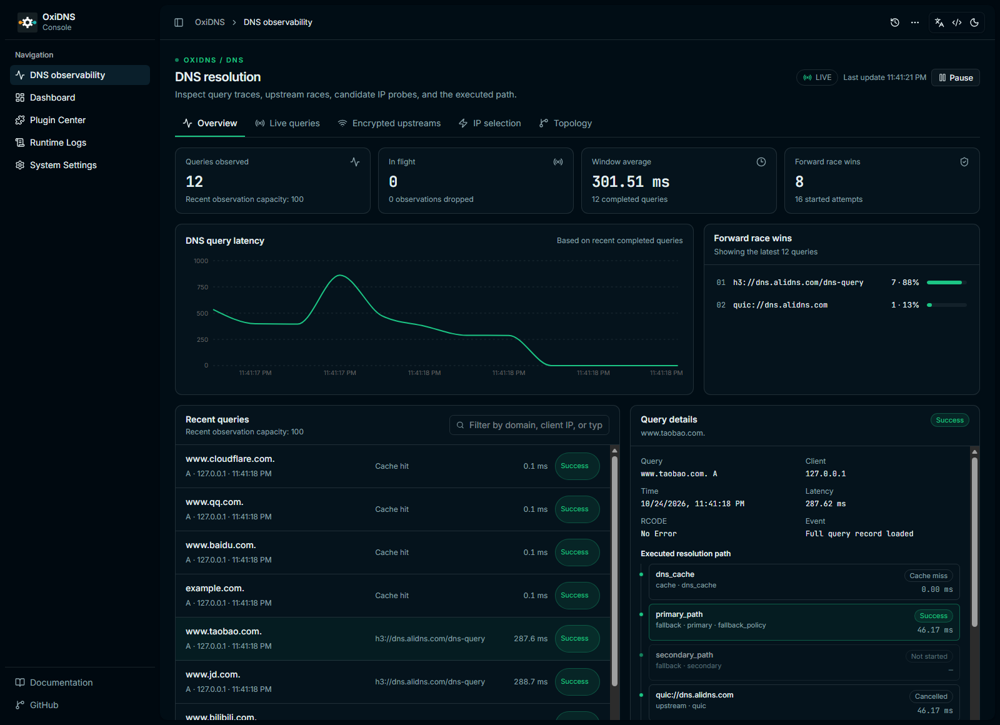
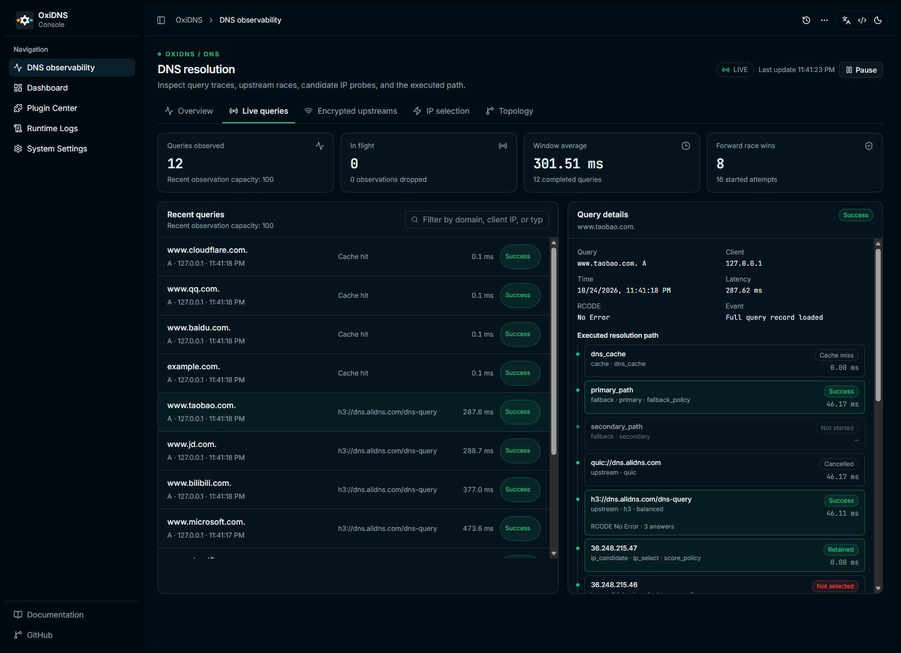
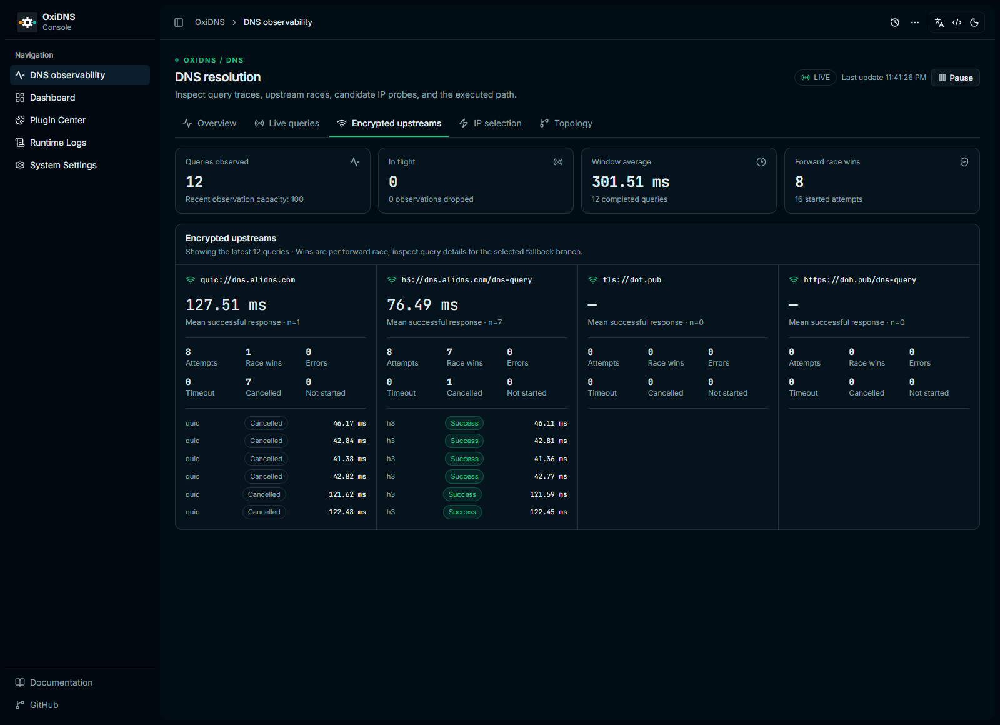
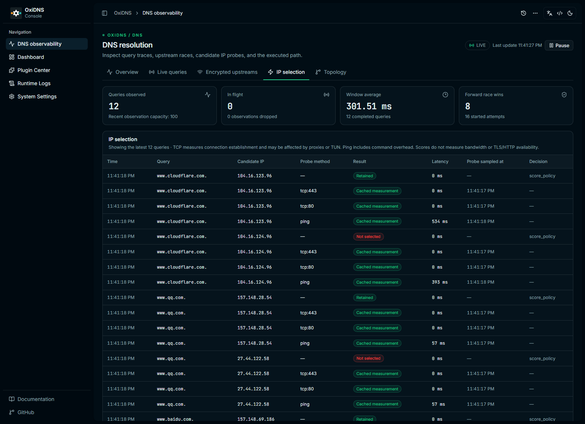
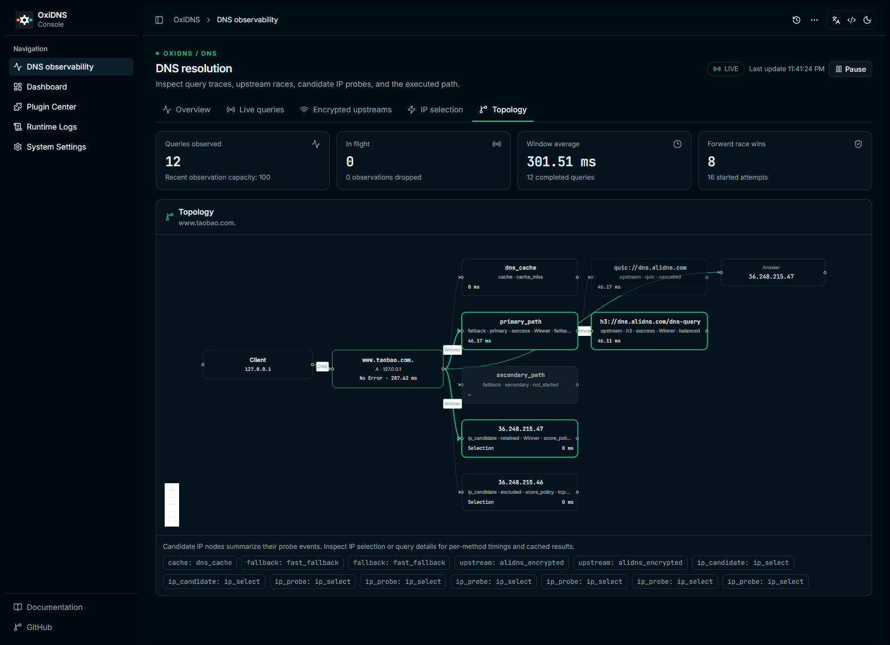

# DNS observability

The `/observability` console page adds recent-query inspection, per-forward
upstream race results, candidate IP measurements and an execution graph. It uses
OxiDNS's existing management API and static WebUI hosting; no additional service
is required. The dashboard, plugin center, configuration editor, runtime logs
and settings remain available.

## Enable detailed collection

Add the optional field to an existing query recorder and keep that executor
near the beginning of the DNS entry sequence:

```yaml
- tag: query_recorder
  type: query_recorder
  args:
    path: ./query-recorder.sqlite
    observe_details: true
```

`observe_details` defaults to `false`. Existing query recording and its payload
shape remain unchanged when details are disabled. Historical records without
observations still load and are labeled as uninstrumented. The new page uses
the first configured query recorder; existing recorder-specific views remain
accessible through the plugin center.

## Reading the views

- **Overview:** recent completed-query durations and per-forward race wins.
- **Live queries:** filter by domain, client IP or type; select a query for
  cache outcomes, upstream attempts, fallback choices, answers and the existing
  plugin execution steps. Pause stops page refresh, not DNS processing.
- **Encrypted upstreams:** configured forward endpoints plus observed attempts,
  mean successful-response durations, race wins, errors, timeouts,
  cancellations and unstarted attempts. This page also accepts plaintext
  forward endpoints if the operator configured them.
- **IP selection:** individual candidate and probe events, methods, scores,
  cached/shared results, measurement timestamps and retention decisions.
- **Topology:** the selected query's recorded parent/child execution
  relationships. Candidate nodes summarize their per-method probe events to
  keep the graph readable; full details remain in the table and query view.
  This is an execution graph, not packet capture or an Internet route map.

A forward race winner can belong to a fallback branch whose response was
discarded. Group wins and the fallback selection are deliberately separate.
Cancelling a losing attempt does not mean that upstream failed. An endpoint
with no samples displays no duration, rather than an invented zero.

TCP probes measure connection establishment and may be affected by proxies or
TUN interception. Ping includes platform command overhead. These measurements
do not establish bandwidth, TLS or HTTP availability. `sampled_at_ms` is an
estimated Unix timestamp in milliseconds, including for reused probe scores.

## API and resource limits

Management routes use the same authentication as the rest of the console:

```text
GET /api/plugins/<recorder-tag>/observations
GET /api/plugins/<recorder-tag>/observations/stream
```

Snapshots are versioned and include enablement, truncation and drop counters.
Each response merges up to 100 recent/in-flight queries. A query retains at
most 128 events; active observations are bounded by the recorder memory-tail size,
capped at 4096. Saturation drops observation details without blocking DNS.
The active registry holds weak references so cancelled requests do not remain
retained.

The WebUI serializes polling rounds at 1.5-second intervals and stops polling
while hidden or paused. SSE publishes snapshots every second and has a
separate 8-stream concurrency limit. Completed details are stored in the
existing SQLite payload using the recorder's retention and cleanup behavior.
Collection adds bounded allocations, locking, serialization and storage work
when enabled. Immutable completed records are shared between the memory tail
and existing SSE subscribers. Observation detail copying occurs outside the
writer's publication lock. No DNS-path blocking I/O is added.

Observations contain queried names and client IPs. Keep management API
authentication enabled and protect the database. Detailed collection begins
at the recorder, so a request short-circuited earlier has no trace here.
Background probes detached from a query are not presented as completed
measurements for that query. CF address-list selection and automatic CF
optimization are outside this change.

## Fork review and attribution

See [the network review](network-review.md) for the branch inventory, exact
source commits, adapted recorder optimization, static export cache fix and
features intentionally kept separate. The shared-record and gap-free SSE
subscription changes adapt wangmice's recorder work; the unversioned route
metadata cache policy extends the HTML-cache approach already in main from
ksong008. Existing API payloads and recorder configuration remain compatible.

## Screenshots from a running build

These screenshots come from a locally running Windows GNU release build and
real UDP/TCP queries for public test domains. They do not contain fabricated
query events or private production query history. The upstream view includes
an isolated fault-injection test: AliDNS was temporarily dialed through an
unused loopback address to exercise Tencent fallback. Tencent DoH was also
temporarily isolated to verify a successful DoT response. The exact original
configuration was then restored. No injected failure remains in these
screenshots. Timings describe this workstation only.

### Overview



### Live queries



### Encrypted upstreams



### Candidate IP selection



### Execution topology


